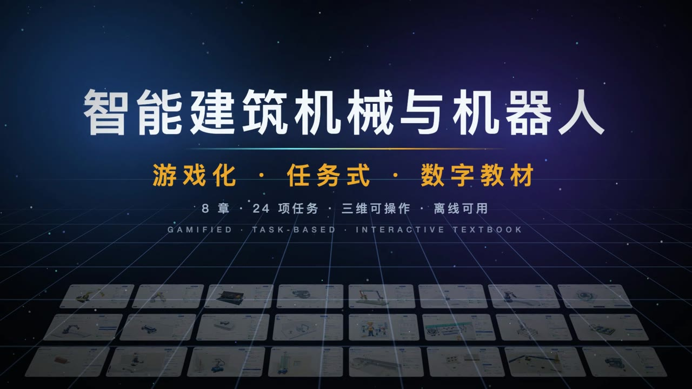
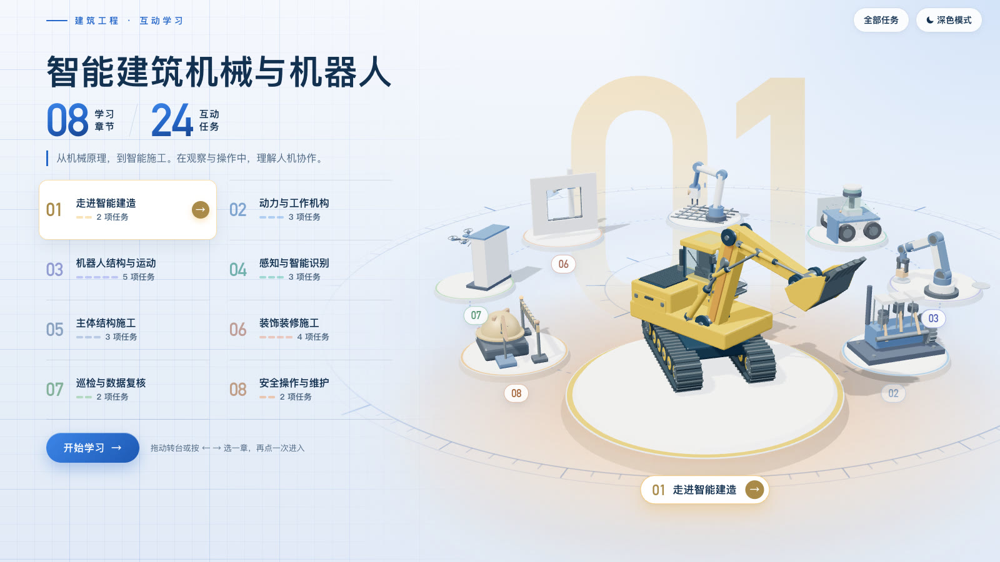
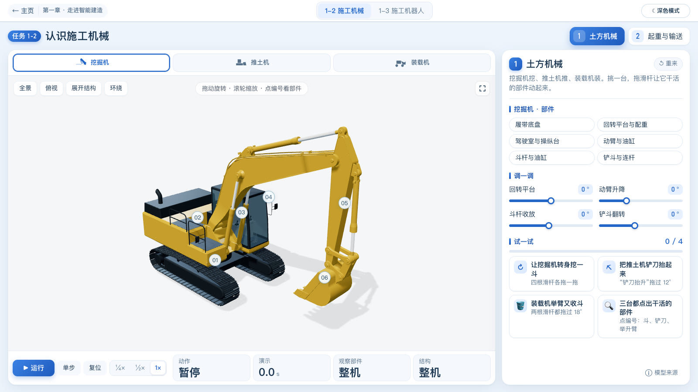
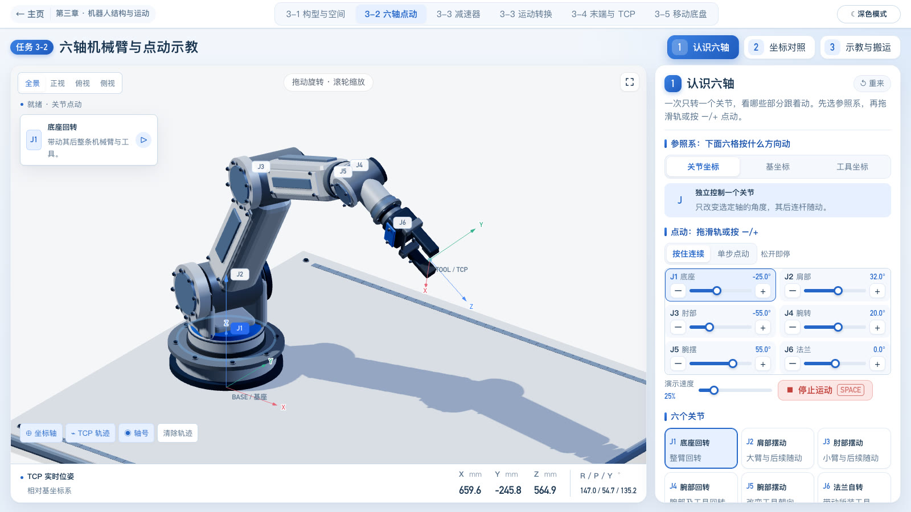
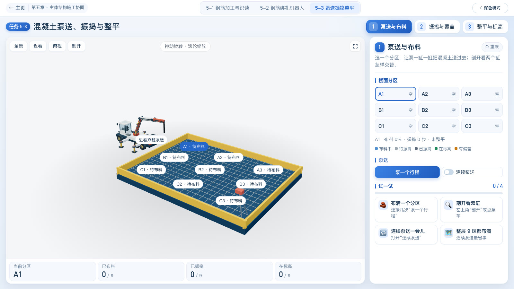
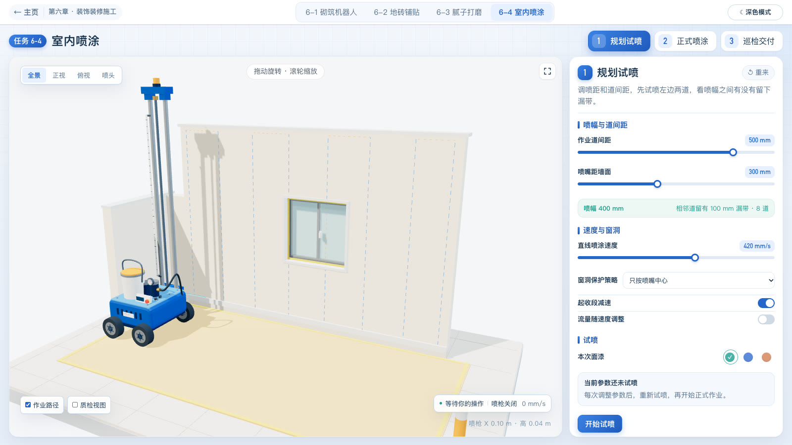
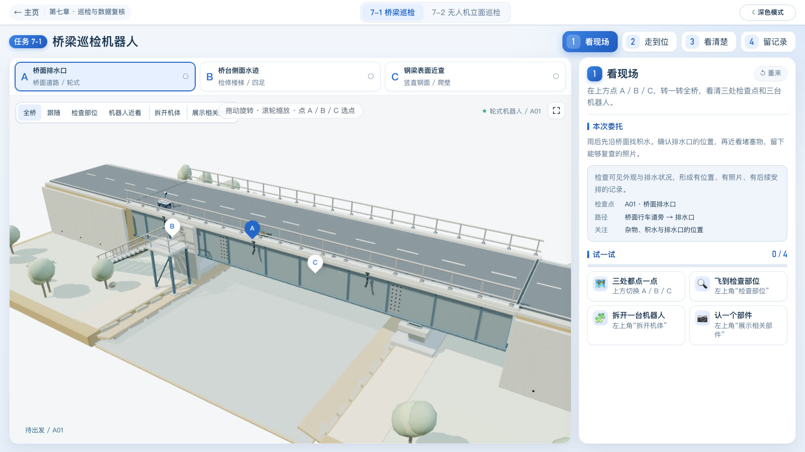

# 智能建筑机械与机器人 · 互动课程

游戏化、任务式的数字教材：8 个章节、24 项活动任务，每项任务都是可以动手操作的三维教学工位。章节负责导览，任务负责教学内容；公共代码、开发产物和历史材料分别保存。

## 在线访问

| 线路 | 网址 | 说明 |
|---|---|---|
| 国外 | **<https://construction-robotics.644019085.workers.dev>** | Cloudflare Workers，执行 `npm run deploy` 时自动更新 |
| 国内 | **<https://artidrop.ai/a/grgIMfRCVJ>** | Artidrop，手动上传 `artifacts/packages/course.zip` |

本地打开：**[课程首页](course/home/index.html)** · [任务清单](course/catalog.json) · [AI 操作协议](AGENTS.md)

## 宣传片

[](https://construction-robotics.644019085.workers.dev/resources/media/promo-720p.mp4)

▶ 点击封面在线观看宣传片（25 秒，720p）。视频文件：[resources/media/promo-720p.mp4](resources/media/promo-720p.mp4)，原片保存在仓库外的 `教材制作/成片/宣传片/`。

## 课程画面

| 课程首页：八章转台 | 1-2 认识施工机械 |
|---|---|
|  |  |
| **3-2 六轴机械臂与点动示教** | **5-3 混凝土泵送、振捣与整平** |
|  |  |
| **6-4 室内喷涂** | **7-1 桥梁巡检机器人** |
|  |  |

画面截自线上版本（1600×900）。三维场景都可以拖动旋转、点选部件，并配有"试一试"关卡。

## 目录结构

```text
website/
├─ course/                 课程页面与源码
│  ├─ home/                课程首页：八章转台 + 各章镜头（#chapter-N）
│  ├─ catalog.json         24 项活动任务的编号、标题和入口
│  └─ chapters/
│     ├─ 01/
│     │  ├─ overview/      旧章节封面地址，跳转到首页 #chapter-1
│     │  └─ tasks/
│     │     ├─ 1-2/        施工机械三维展厅
│     │     └─ 1-3/        机器人三维展厅
│     └─ 02/ … 08/         其余章节采用相同结构
├─ shared/                 唯一公共资源目录
│  ├─ vendor/              第三方库与许可证
│  ├─ styles/              各章共用入口样式
│  ├─ navigation.js        统一站点路径解析
│  └─ 各教学主题/          章节导航、共用界面和教学组件
├─ resources/              原始资料
│  ├─ media/               宣传片（随网站发布）
│  └─ robot-atlas/         原网址兼容跳转；完整图鉴已归档
├─ scripts/                构建、检查、打包和部署工具
├─ .github/readme/         本说明用到的截图与宣传片封面
├─ artifacts/              开发产物（不进入 Git）
│  ├─ screenshots/         全部检查截图及历史截图
│  ├─ packages/            课程 ZIP、模型 ZIP、迁移备份
│  ├─ reports/             检查报告和构建日志
│  ├─ builds/              个别任务的额外 HTML 构建结果
│  └─ site/                可直接部署的网站
├─ archive/                历史版本、本地工作副本、旧工具（不进入 Git）
├─ index.html              打开课程的兼容入口
├─ wrangler.jsonc          Cloudflare 部署配置
└─ package.json            统一命令
```

教材正文（Word、各章《学生操作与关卡指南》、教材正文快照）不放在仓库里，统一保存在仓库外一层的 `教材文档/`，不上传 GitHub，也不随网站发布。

## 日常使用

需要 Node.js 20+ 和 Python 3.9+。课程构建使用系统自带模块；只有部署和浏览器测试需要先执行 `npm install`。

```powershell
npm run build                       # 构建全部课程，统一公共资源引用
node scripts/build.mjs 6             # 只构建第六章（1—8 均可）
node scripts/build.mjs 6-2           # 只构建任务 6-2
npm test                            # 模型测试
npm run check                       # 页面及说明文档的本地链接
npm run verify                      # 一次完成构建、测试、链接检查和打包
npm run package                     # 网站写入 artifacts/site，ZIP 写入 artifacts/packages
npm run serve                       # 从仓库根目录提供 HTTP 预览
npm run preview                     # 只预览已打包的网站
npm run build:models                # 更新共享机器人离线资源（含机械手）
npm run deploy -- cf                # 打包并发布到 Cloudflare（国外线路）
```

在 Windows PowerShell 中如 npm.ps1 被执行策略拦截，可使用 `npm.cmd`，或直接执行 scripts/ 中相应的 Node/Python 命令。

## 修改哪里

- 修改某个任务：进入 `course/chapters/章节编号/tasks/任务编号/`。有 `src/` 的任务改源码后通过统一命令构建；最初直接编写的 HTML 继续作为该任务的维护文件。
- 修改课程首页与章节导览：进入 `course/home/`。章节封面已并入首页（`#chapter-N` 镜头状态）；各章 `overview/index.html` 只保留为跳转页。
- 修改共同导航、样式和组件：只改 `shared/`；首页与各章展品模型在 `shared/chapter-cover/` 和 `shared/workshop/`。
- 新截图放入 `artifacts/screenshots/章节或任务编号/`，新 ZIP 放入 `artifacts/packages/`。教学图片和测试输入保留在任务的 `assets/`、`qa/fixtures/` 或 `qa/source/`，不按扩展名当作截图搬走。

## 发布

1. `npm run package`：打包网站，写入 `artifacts/site/` 和 `artifacts/packages/course.zip`。网站入口是包根目录的 `index.html`；公共资源依靠相对路径加载，必须保持目录结构。
2. 国外线路：`npm run deploy -- cf` 会重新打包并发布到 Cloudflare。首次使用前执行一次 `npx wrangler login`。
3. 国内线路：把 `artifacts/packages/course.zip` 上传到 Artidrop。`npm run deploy -- eo` 可发布到腾讯云 EdgeOne Makers，但目前腾讯云接口在上传环节报 `Project is not exist`，暂时无法使用。

本轮整理保留了教学内容与证据边界：任务导读、数字仿真和现场结果的含义不因目录调整而改变。

本轮改版：第一章保留机械与机器人两项三维展厅；5-3 为混凝土互动，入口名为 `index.html`；第八章合并为安全操作与保养排查。AI 修改前须阅读 [AGENTS.md](AGENTS.md)。
