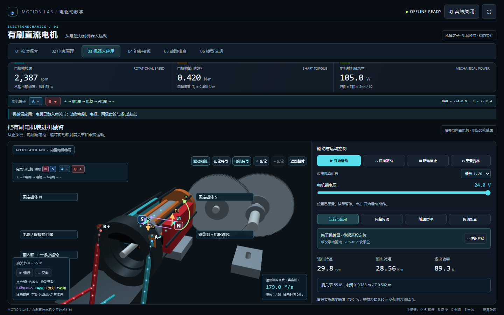

# 有刷直流电机互动教学实验室

暗色科技风的中文交互教学网页，展示从电流、磁场与电磁转矩，到肩关节内置电机、两级减速传动和机械臂关节运动的关系。

原生 HTML / CSS / JavaScript，三维场景使用 WebGL，音效使用 Web Audio。**无运行时第三方依赖，无需编译，可离线打开，也可发布到 GitHub Pages。**



## 运行

下载或克隆本仓库，保留目录结构，双击 `index.html`。

也可以在仓库目录启动静态服务器，例如已安装 Python 时运行：

```sh
python -m http.server 8000
```

然后打开 `http://localhost:8000`。建议使用支持 WebGL 的现代桌面浏览器；未启用 WebGL 时使用二维备用示意。音效默认关闭，需要用户点击后开启。

## 教学内容

- **构造探索**：旋转视角、剖切、组件名称、正负极与传统电流方向，观察电刷、换向器、转子绕组和定子磁体。
- **固定磁极标识**：模型与图例清楚区分 N（北极）、S（南极）和 A/B 电源端子；反接只交换端子极性，固定永磁体的 N/S 不变。
- **电流粒子**：沿导线与等效线圈导体显示传统电流方向；反接反向，断电消失，堵转通电时仍继续流动。暂停与减少动态效果模式会冻结粒子。
- **点击名称放大**：三维构造图和机械臂图中的部件名称可直接点击，也可聚焦后按 Enter / 空格；支持磁体、电刷、换向器、绕组、齿轮、关节和末端。点击“返回整机 / 返回整臂”恢复视图。
- **标注选择**：顶部下拉菜单可分别勾选部件名称、正负极、N/S 磁极、电流粒子、B/I/F/τ 箭头、传动方向线和模型状态提示，电机与机械臂同步应用，切页保留选择。“隐藏标注 / 显示标注”支持一键隐藏并恢复之前的选择；电机运行与参数不受影响。
- **三维受力示教**：在实际导线位置叠加 N→S 磁场 B、传统电流 I、导线受力 F 和转矩 τ；反接时 I、F、τ 同步反向，磁场不变。提供 0° / 45° / 90° / 135° 定格观察及箭头开关；去掉部件名称的长指引线。
- **电磁原理**：磁场、电流和受力形成转矩；换向、单线圈角度示教及转速—转矩关系。
- **机械臂应用**：电机、电刷端子、绕组和减速器集成在肩关节中；整臂、齿轮、电机三种观察视图；完整追踪输入轴、复合轴、输出法兰与关节链。默认减速 80:1（8×10），观察慢放 1/20。
- **极性与使用状态**：各教学页持续显示 A/B 端子正负极、UAB、电流与传统电流方向；反接时实时交换，断电时清除通电标识。
- **巡检定位**：可选 30°–85° 往返运行，端点先断电停留再反接；“运行使用 / 完整传动 / 轴速功率 / 传动配置”分栏切页，分别查看运动、传动关系、能量损失和参数。
- **增减齿轮**：在两级减速链中增减 0–2 个惰轮；显示齿轮数量及外啮合次数；每增减一个惰轮，输出方向反转，总减速比幅值保持不变。调整时自动断电，再点击运行。
- **组装接线**：安装组件、选择接线、预测方向、通电验证。
- **故障排查**：电刷接触不良、接线开路、负载过大；通过测量判断，断电修复后验证恢复。

页面以标签切换。手机端可在模型画面与控制面板之间切换。机器人运行时，先暂停演示再调整减速比。点击三维图中的部件名称聚焦放大，拖动三维画面旋转，滚轮缩放；聚焦机器人画布后可使用方向键微调视角。

快捷键：`空格` 暂停、`R` 反接、`C` 剖切、`S` 音效。组装和故障模式会限制不适用的操作。

## 上传 GitHub 并展示网页

1. 创建一个 GitHub 仓库，例如 `brushed-dc-motor-lab`。
2. 将**本目录内所有文件和文件夹**上传到仓库根目录，确保根目录有 `index.html`，同时保留 `assets/` 和 `docs/`。
3. 在仓库的 **Settings → Pages** 中，选择 **Deploy from a branch**。
4. 选择包含源码的分支（通常为 `main`）及根目录 `/ (root)`，保存。
5. 部署完成后，用 Pages 页面给出的链接分享给同学。普通项目仓库的网址通常为 `https://你的用户名.github.io/仓库名/`；源码可直接在仓库中查看。

`.nojekyll` 用于按静态文件发布。部署选项以 [GitHub Pages 官方说明](https://docs.github.com/en/pages/quickstart) 为准。

## 源码结构与修改入口

```text
.
├── index.html           # 教学页面结构、控件与二维 SVG
├── assets/
│   ├── styles.css       # 暗色主题、布局与响应式样式
│   └── app.js           # 电机模型、交互、WebGL、音效与教学挑战
├── docs/
│   ├── preview.png      # 项目预览
│   └── MODEL.md         # 公式、参数与教学简化
├── .nojekyll
├── .gitignore
└── README.md
```

在 `assets/app.js` 中搜索以下名称定位代码：

| 名称 | 用途 |
| --- | --- |
| `state`、`C` | 工作点、显示状态和电机参数 |
| `solve`、`operatingModel` | 稳态电机方程和故障模型 |
| `render`、`renderApp` | 读数和应用界面更新 |
| `setupPages` | 教学分页 |
| `electromagneticFrame`、`drawElectromagneticVectors` | 三维电流、磁场、受力和转矩的计算与投影 |
| `setupSceneLabels` | 构造标签、电流与极性标记 |
| `beginStudent` | 学生组装流程 |
| `beginFault`、`startFaultCase` | 故障挑战 |
| `createRobotScene` | 机械臂、内置电机、运动学、相机和齿轮传动 |

浏览器开发者工具控制台中的 `window.motorLab` 提供模型计算与诊断快照，例如：

```js
motorLab.solve(24, 0.42); // 电压 V、轴负载 N·m
motorLab.getModel();     // 当前稳态工作点
motorLab.getRobot();     // 齿轮数量、轴角度、巡检状态和关节姿态
```

这些诊断接口返回快照；界面操作通过内部状态与渲染流程完成。

## 模型说明与参考

该项目使用教学假设参数。电机稳态模型、单线圈换向图和应用运动学的适用范围见 [MODEL.md](docs/MODEL.md)，页面“模型说明”中也有说明和原理参考链接。
