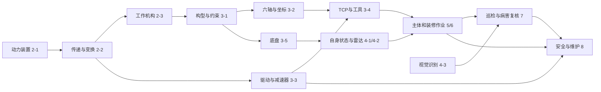

# 《智能建筑机械与机器人》交互辅助资源大纲

规划日期：2026年10月13日。依据：[飞书教材入口](https://my.feishu.cn/wiki/AzWbw1IkHiis57kieL1cKEYanAh)。

这套资源围绕教材中的具体知识点，辅助学生看清机械内部怎样运动、机器人为什么这样运动，以及现场操作会产生什么结果。每个任务独立考虑适合做什么：有的以三维剖切动画为主，有的适合二维关系实验、示教面板、照片标注、现场情境或故障诊断。交互形式随内容选择，学生可以直接进入一个演示，也可以沿关联任务继续探索。

本目录包含 **8个主题、27份逐任务方案**。任务来自飞书当前的14个子页面，不沿用旧版教材的30或34任务目录。这里的编号用于组织辅助资源，保留飞书原任务标题；各任务文档保留制作方案。主题四已提供[蓝白教学演示入口](../公共资源/感知与识别/index.html)，含4-1自身状态、4-2激光雷达与点云，以及4-3独立的标注／预测／评估页面。主题五新增[5-1钢筋加工与作业面大型三维沙盘](../任务5-1_钢筋加工机械与绑扎作业面识读/index.html)，可以离线旋转观察、慢放机械并完成识读练习。另有[5-2钢筋绑扎机器人单点实验室](../任务5-2_钢筋绑扎机器人操作与人工复核/index.html)，以16:9固定一屏展示动作剖面、卡丝回放和人工复核。任务6-3已提供[腻子打磨机器人实验室](../任务6-3_腻子打磨_作业面检查_恒力执行与质量验收/index.html)，聚焦恒力退让、局部驻留、空跑与洞口覆盖，支持16:9单屏离线演示。原5-3演示入口已迁移至6-3，5-3恢复为方案状态。任务6-4已提供[喷涂机器人实验室](../任务6-4_室内喷涂_路径规划_参数控制与缺陷诊断/index.html)，以16:9单屏联动展示喷幅搭接、洞口停喷和速度与相对沉积。第三主题保留构型、六轴机械臂、关节驱动、末端工具与移动底盘五个演示；第二主题已有柴油机页面。各项目入口与维护位置见[项目目录](../项目目录.md)，未提供入口的内容按任务方案记录。已有网页的实际功能和复用条件另见[现有资源复用清单](../现有资源复用清单.md)。

## 项目导航

先看[项目目录与维护说明](../项目目录.md)，按任务查找演示、源码、素材与历史编号说明。

## 一、整体效果与组织方式

新增[任务5-1 砌砖机器人教学演示](../任务6-1_砌筑工程_人工工艺_砂浆机械与机器人进场/index.html)：按本次制作任务编号命名，对应原目录6-1砌筑内容。含单砖取放、两皮错缝、灰缝与柔顺接触三个交互实验，支持16:9单屏全屏、单步慢放、深浅主题和离线打开。

入口可以是一栋可切换阶段的教学楼：土方与基础、主体结构、装饰装修、投入使用后的巡检管养。点击挖掘机、机器人、钢筋网、墙面或立面，进入相应原理或操作演示。也保留按教材任务浏览的目录，两种入口通向同一批资源。

原理演示以结构与运动为主。例如在柴油机剖面中拖动曲轴角度，活塞、气门、喷油和工作阶段随相位变化；在机械臂旁切换点动参照，同一个方向按钮会引起不同的工具轨迹。施工演示以真实工作对象为主，例如同一墙面用于砌筑、打磨和喷涂，同一楼面用于整平与铺砖，保留各自的动作和质量现象。安全与维护则适合事件分支、部件检查和故障证据比较。

一份任务方案可以包含多个小演示；多个任务也可以共用一套三维场景。文档按任务分开，程序不必机械地拆成27个互不相关的网站。整体统一的是设备、对象、坐标、术语和必要的参数传递，不统一学生每一步要做的动作。

## 二、逐任务总览

“主形式”指最适合先做的呈现方式。每份方案进一步列出交互点、画面变化、样例和扩展，优先实现有解释价值的部分。

### 主题一：走进智能建造现场

| 任务与方案 | 主形式 | 值得做的内容与大致效果 | 与其他任务的联系 |
| --- | --- | --- | --- |
| [1-1 从建造施工到智能建造](../任务1-1_从建造施工到智能建造/README.md) | 工地情境切换、前后对照 | 同一现场在传统和智能施工间切换；点击高处、重物、粉尘、重复作业位置，查看技术能处理哪些问题、还需要谁负责。政策与定义保留短文或资料卡。 | 为各主题提供同一栋教学楼和工程问题入口。 |
| [1-2 认识施工机械](../任务1-2_认识施工机械/README.md) | 设备热区、施工阶段地图 | 六类机械按阶段出现；点击部件和动作，看到挖掘、运输、吊装、泵送等职责及作业范围。 | 设备进入2-1～2-3原理演示；混凝土与钢筋继续到5-1～5-3。 |
| [1-3 认识施工机器人](../任务1-3_认识施工机器人/README.md) | 感知—控制—执行联动示意 | 给同一移动设备增减传感器、控制与执行功能；改变障碍位置，观察信息反馈与设备动作之间的关系。 | 引出主题三的机器人本体、主题四的感知，以及施工中的人机分工。 |

### 主题二：建筑机械硬件基础

| 任务与方案 | 主形式 | 值得做的内容与大致效果 | 与其他任务的联系 |
| --- | --- | --- | --- |
| [2-1 动力装置的基本原理](../任务2-1_动力装置的基本原理/README.md) | 柴油机剖切、电机磁场与转子动画 | 四冲程720°相位、活塞与曲柄连杆、气门与喷油；电机通电换向与连续转动；转速、转矩、功率通过负载比较呈现。 | 连杆进入2-3；电机驱动进入3-3；输出转速与转矩进入2-2。 |
| [2-2 动力的传递与变换](../任务2-2_动力的传递与变换/README.md) | 齿轮比例实验、液压与气压回路 | 更换齿数观察方向和转速；比较带、链传动；切换液压阀和缸两侧进回油，看到流向、伸缩与受力的关系。 | 通用传动供3-3减速器理解；液压参数和缸行程供2-3工作机构使用。 |
| [2-3 工作机构与施工动作](../任务2-3_工作机构与施工动作/README.md) | 可拖动连杆、动臂与丝杠 | 拖动铰点或改变缸伸长，观察动臂角度、斗尖轨迹和死点附近动作；丝杠旋转带动平台直线进给。 | 把动力链接到具体施工动作；约束与运动关系引出3-1构型。 |

### 主题三：机器人构型与运动

| 任务与方案 | 主形式 | 值得做的内容与大致效果 | 与其他任务的联系 |
| --- | --- | --- | --- |
| [3-1 机器人构型与工作空间识读](../任务3-1_机器人构型与工作空间识读/README.md) | [打开五种构型交互实验室](../任务3-1_机器人构型与工作空间识读/index.html) | 五种机械构型；独立变量、锁轴与连接约束；可变行程／工具长度的空间采样；目标位置逆解；立柱与材料箱干涉；关节直连／预置绕行对照。16:9 单屏、单文件离线运行。 | 位置可达不等于指定姿态可达或路径可通过；工具朝向求解与通用自动避障仍为后续规划。 |
| [3-2 六轴机械臂本体、关节轴与低速点动](../任务3-2_六轴机械臂本体_关节轴与低速点动/README.md) | [打开六轴机械臂交互实验室](../任务3-2_六轴机械臂本体_关节轴与低速点动/index.html) | J1～J6 单轴演示与点动；关节／基／工具坐标；TCP 位姿与轨迹；同起点 +Z 方向对照；示教记录与 PTP 回放；抓取搬运挑战。单文件离线运行，支持浅／深主题与手机。 | 固定基座教学模型；移动底盘、工件坐标和 LIN／CIRC 仍为后续规划。 |
| [3-3 关节驱动、减速器与传动机构](../任务3-3_关节驱动_减速器与传动机构/README.md) | [交互动画](../任务3-3_关节驱动_减速器与传动机构/index.html) · [96秒字幕视频 MP4](../任务3-3_关节驱动_减速器与传动机构/media/joint-drive-lesson.mp4) | 伺服指令／动力／反馈；行星公转与自转；谐波柔轮与两处啮合；RV 两级结构分层；丝杠、齿条与连杆；参数筛选与字幕联播。 | RV 为结构与传递顺序示意，未实现完整啮合运动；单文件离线、16:9 单屏。 |
| [3-4 末端执行器、TCP与工具控制](../任务3-4_末端执行器_TCP与工具控制/README.md) | [打开末端工具与 TCP 实验室](../任务3-4_末端执行器_TCP与工具控制/index.html) | 沿用 3-2 六轴本体与运动学；六种工具及特写；快换确认；真实／所选 TCP 轨迹对照；四点 QR 位置标定；重复姿态和错点反例；新姿态复核与 JSON 记录。 | 四点法求位置偏置，工具轴方向另行定义；无后台、单文件离线、16:9 单屏。 |
| [3-5 移动底盘与行走机构](../任务3-5_移动底盘与行走机构/README.md) | [打开三维机构与驾驶闯关](../任务3-5_移动底盘与行走机构/index.html) | 双轮差速、转向轮与麦克纳姆轮操纵及九个预测验证实验；履带链板追踪、四足支撑分解与轨道侧移约束，支持同步时间轴和单步；轮组特写与上罩拆开；四阶段十二关驾驶挑战，含连续绕行、窄道、指定朝向检查点、倒车返库、碰撞限制、半速精调、星级与记录下载；右栏按操作、观察与验证分卡组织。 | 爬壁退出本页；空间通行改为驾驶任务。运动与显示共用模型，按完整平面包络检查干涉，不计算滑移、沉陷、跨障或动态稳定。离线单文件，支持桌面与手机。 |

### 主题四：机器人感知与识别

| 任务与方案 | 主形式 | 值得做的内容与大致效果 | 与其他任务的联系 |
| --- | --- | --- | --- |
| [4-1 机器人自身状态感知](../任务4-1_机器人自身状态感知/README.md) | 动作与波形同步、手机数据观察 | 移动、倾斜、振动时同步显示编码器、加速度、角速度等；真实手机记录与模拟例子分别标示，展示漂移和信息缺口。 | 从3-3反馈走向设备状态判断；给8-2维护提供波形证据。 |
| [4-2 机器人激光雷达感知](../任务4-2_机器人激光雷达感知/README.md) | 激光扫描几何与真实点云 | 射线扫描形成点集；改变遮挡、扫描高度和机器人宽度观察漏检与通行判断；真实点云可旋转、切片与测距。 | 复用3-5底盘；后续路线与巡检使用同一通道；SLAM作为关联扩展。 |
| [4-3 标注安全帽并应用YOLO模型](../任务4-3_标注安全帽并应用YOLO模型/README.md) | 图像标注、学习示意、模型结果对照 | 矩形/多边形等标注；像素坐标与归一化标签；数据分组；训练与推理；调阈值比较误检漏检，并转到裂缝案例。 | 与7-1、7-2共用原图、标注与复核方法；病害识别使用对应模型，不混用安全帽预测。 |

### 主题五：主体结构施工

| 任务与方案 | 主形式 | 值得做的内容与大致效果 | 与其他任务的联系 |
| --- | --- | --- | --- |
| [5-1 钢筋加工机械与绑扎作业面识读](../任务5-1_钢筋加工机械与绑扎作业面识读/README.md) | 钢筋加工动作、钢筋网空间观察 | 调直、切断、弯曲动作演示；旋转钢筋网查看间距、交叉点、支撑与机器人能否进入。 | 加工机构回到2-3；同一钢筋网和可作业点交给5-2。 |
| [5-2 钢筋绑扎机器人操作与人工复核](../任务5-2_钢筋绑扎机器人操作与人工复核/README.md) | 绑扎头剖切、连续作业与异常回放 | 对点、送丝、绕丝、切断、收紧与转移；注入卡丝、漏绑、目标偏移，查看需要人工复核的位置。 | 使用3-4工具与5-1作业面；异常材料进入8-2维护。 |
| [5-3 混凝土泵送布料与整平抹光机器人](../任务5-3_混凝土泵送布料与整平抹光机器人/README.md) | 泵送布料、激光整平与抹光工序 | 方案状态；后续围绕楼面施工工艺单独制作。此前演示已改为6-3腻子打磨主题。 | 泵送回到2-2液压；同一地面供6-2铺砖；维护见8-2。 |

### 主题六：装饰装修施工

| 任务与方案 | 主形式 | 值得做的内容与大致效果 | 与其他任务的联系 |
| --- | --- | --- | --- |
| [6-1 砌筑工程：人工工艺、砂浆机械与机器人进场](../任务6-1_砌筑工程_人工工艺_砂浆机械与机器人进场/README.md) | 墙体砌筑序列、夹取放置示教 | 铺浆、排砖、错缝、灰缝与洞口；供料、夹取、放置和柔顺接触；同一墙面形成后续装修对象。 | 使用3-2/3-4机械臂与工具；墙面传给6-3、6-4及管养巡检。 |
| [6-2 地砖铺贴：工艺准备与铺贴机器人作业](../任务6-2_地砖铺贴_工艺准备与铺贴机器人作业/README.md) | [地砖铺贴机器人实验室](../任务6-2_地砖铺贴_工艺准备与铺贴机器人作业/index.html) · 16:9 单屏 | 已实现视觉纠偏与遮挡、四吸盘搬运联锁、压实与完成面标高及缺胶对照；支持离线、全屏、暂停、慢放和单步。整房排砖保留为扩展。 | 继承5-3地面；复用3-4吸盘及4-1状态反馈。 |
| [6-3 腻子打磨：地图配准、空跑与受控接触](../任务6-3_腻子打磨_作业面检查_恒力执行与质量验收/README.md) · [打开教学演示](../任务6-3_腻子打磨_作业面检查_恒力执行与质量验收/index.html) | 恒力退让、驻留与磨料、空跑与覆盖 | 已提供16:9单屏演示：单磨盘墙面接触、固定位置对照、行程与停机；比较驻留和磨料；错位空跑、洞口抬盘转移、覆盖与人工复核。 | 复用3-4磨盘、4-1反馈；墙面与路线继续供6-4喷涂；集尘与维护见8-4。 |
| [6-4 室内喷涂：路径规划、参数控制与缺陷诊断](../任务6-4_室内喷涂_路径规划_参数控制与缺陷诊断/README.md) | [喷涂机器人交互实验室](../任务6-4_室内喷涂_路径规划_参数控制与缺陷诊断/index.html) | 已提供16:9单屏离线演示：喷幅与道间距、洞口触发逻辑、速度与相对沉积；支持喷头近看、全屏、暂停与单步。其余内容保留在任务方案中。 | 同时调用坐标、TCP、驱动与感知；结果供7-1巡检、8-2/8-4排查维护。 |

### 主题七：监测管养

| 任务与方案 | 主形式 | 值得做的内容与大致效果 | 与其他任务的联系 |
| --- | --- | --- | --- |
| [7-1 巡检机器人：轮式、四足与爬壁](../任务7-1_巡检机器人_轮式_四足与爬壁/README.md) | 路线、视野与立面采集 | 三类机器人在通道与立面巡视；比较路线覆盖和照片可用性；负压腔、密封与泄漏可切换剖面观察。 | 使用3-5、4-2、4-3；照片交给7-2；爬壁安全深入到8-3。 |
| [7-2 无人机巡检、病害检测与数据复核](../任务7-2_无人机巡检_病害检测与数据复核/README.md) | 航线成像、回波示意、图像量测 | 相机视角与拍摄覆盖；探地雷达扫描形成回波图；四角平面标定、裂缝两点量测与误差对照。 | 复用7-1病害照片与4-3标注、预测复核方法；病害结果绑定对应类别和模型，补充尺度证据。 |

### 主题八：安全与维护

| 任务与方案 | 主形式 | 值得做的内容与大致效果 | 与其他任务的联系 |
| --- | --- | --- | --- |
| [8-1 机械与机器人的安全操作规程](../任务8-1_机械与机器人的安全操作规程/README.md) | 工地危险源、操作状态分支 | 查找能量源、禁入区与操作冲突；观察启动、急停、复位、重新启动的状态差别。 | 随时从机械、点动和施工网页跳入相应安全案例。 |
| [8-2 设备保养、故障排查与维护记录](../任务8-2_设备保养_故障排查与维护记录/README.md) | 部件检查与证据诊断 | 设备剖解、旧油异响；通过换向与姿态实验区分背隙、零点偏移、奇异位形，比较排查依据。 | 复用2-2/3-3传动、3-2机械臂、4-1波形及施工异常。 |
| [8-3 爬壁与特种作业机器人安全检查](../任务8-3_爬壁与特种作业机器人安全检查/README.md) | 吸附原理与多条件安全情境 | 改变壁面、吸附方式、供电与防坠状态；观察泄漏或失电后哪些保护条件仍然有效。 | 复用7-1爬壁模型；把原理观察延伸到停机和安全检查。 |
| [8-4 装修机器人职业健康与清洗维护](../任务8-4_装修机器人职业健康与清洗维护/README.md) | 粉尘/雾化传播、清洗操作分支 | 比较集尘与通风条件；查看残余压力和污染部位；按设备状态选择停机、泄压、清洗与维护动作。 | 承接6-3打磨、6-4喷涂和8-1能量隔离。 |

## 三、任务之间怎样连通

### 1. 共用设备与工作对象

| 共享对象 | 使用位置 | 保持一致的内容 |
| --- | --- | --- |
| 教学楼现场 | 1-1、1-2、5、6、7、8各主题 | 同一工程空间在施工与使用阶段的变化、区域名称和问题位置。 |
| 挖掘机动力与动臂 | 2-1、2-2、2-3、8-2 | 发动机、液压泵、液压缸、连杆的连接及动作方向。 |
| 移动六轴施工机器人 | 3-1～3-5、5-2、6-1～6-4、8-2 | 基座、关节、法兰、工具中心点的定义；模型和工具切换保持同一参照。 |
| Wall-A：带门窗墙面 | 3-1、3-2、3-4、6-1、6-3、6-4、7-1 | 尺寸、洞口、墙面朝向与作业边界。 |
| Floor-A：楼面 | 5-3、6-2、7-1 | 地面参照、标高与局部质量问题的空间位置。 |
| Rebar-A：钢筋网 | 5-1、5-2、7-1 | 同一组交叉点、缺陷位置与人工复核状态。 |
| Route-A：地库/管廊通道 | 3-5、4-2、7-1 | 通道几何、机器人外形与障碍位置。 |
| Facade-A：楼宇立面 | 7-1、7-2、8-3 | 裂缝、遮挡、采集区域、吸附壁面条件与照片点位。 |

这些对象可以在不同任务中换视角、剖面或尺度，不需要每页都完整加载整栋楼。四冲程、电机、齿轮等小实验也可以单独打开，点击“在设备中看应用”再回到共享场景。

### 2. 原理、操作与工程应用的关联

图中的线表示解释关系或可复用内容，不是强制学习顺序。典型串联可以有以下几条：

- **挖掘机动作线**：柴油机带动泵→阀控制油液→液压缸伸缩→连杆与动臂运动→某个动作异常时查看供能或机构证据。
- **机械臂施工线**：自由度与工作空间→点动参照→电机和减速器→TCP换工具→在同一墙面完成砌筑、打磨、喷涂中的一种作业。
- **移动巡检线**：底盘能怎样移动→状态传感器知道什么→雷达看到了什么→路线是否可走、照片是否可用→病害复核与安全处理。
- **质量与维护线**：错误工具参数、未对齐地图或异常反馈→作业现象→巡检证据→排查原因。学生可以直接从异常现象反向进入相关原理。

### 3. 有意义的参数和成果传递

| 上游内容 | 下游用途 | 连通时的具体效果 |
| --- | --- | --- |
| 2-1输出转速、2-2传动比 | 2-3工作机构、3-3关节驱动 | 同一输入变化后，看到输出转速或机构运动变化；只有兼容的传动模型才传递数值。 |
| 3-4工具长度与TCP偏置 | 3-2点动、6-1/6-3/6-4作业 | 切换喷嘴或磨盘后，轨迹和真实工作点一起更新；可对比错误工具配置。 |
| 3-5底盘宽度与转弯方式 | 4-2通行判断、7-1路线 | 相同通道内更换底盘后，可通过宽度和转弯路线发生变化。 |
| Wall-A尺寸、洞口与作业区域 | 构型可达性、打磨、喷涂、巡检 | 墙面改动在关联页沿用；保留坐标和对象名称，避免每页重建同一墙。 |
| 7-1采集的照片与点位 | 4-3病害识别扩展、7-2量测 | 原图、拍摄位置、比例尺与病害模型结果对应，能追溯漏拍、模糊及标定条件；结果保留任务类别、类别表和模型版本。 |
| 施工异常与波形片段 | 8-2排查、8-4维护 | 查看同一异常出现时的动作和数据，而非另换一个无关故障故事。 |

各页提供默认示例，缺少前序成果时仍能直接使用。需要延续的场景配置可自动在本机保留，也可导入/导出；纯原理动画不必要求提交记录。照片、点位、工具参数和诊断案例应保留其来源与版本，以免旧参数被误用于新设备。

## 四、哪些内容用三维，哪些用其他形式

| 内容特征 | 优先形式 | 代表任务 |
| --- | --- | --- |
| 内部零件运动或空间约束很难从静图理解 | 剖切、透明、爆炸图、自由观察的3D动画 | 四冲程、动臂连杆、六轴关节、RV/谐波、TCP。 |
| 关键在比例、方向、流向或数值关系 | 2D动画与曲线；需要时附3D视角 | 齿轮传动、液压回路、状态波形、喷涂覆盖。 |
| 关键在实际操作的参照、动作或状态 | 仿真操作面板、点动按钮、事件回放 | 六轴点动、工具控制、绑扎操作、急停与复位。 |
| 关键在图像与数据的对应 | 标注画布、双图对照、点云查看器、数据列表 | YOLO、雷达、病害照片、裂缝测量。 |
| 关键在现场条件和人的判断 | 场景卡、局部热区、证据选择、可回看的分支 | 设备选型、进场条件、质量复核、安全维护。 |
| 材料涉及政策、真实工法或设备细节 | 简洁资料卡、原视频、现场照片与短说明 | 智能建造政策、真实设备操作、规范与工艺依据。 |

复杂三维投入优先用于“看不到、看不清、难以亲手试”的内容。不能用动画直接验证的实物质量，例如地砖空鼓或结构病害性质，网页展示风险和复核方法，结论依靠相应证据。

## 五、制作顺序

### 第一批：机械和机器人核心原理

先做2-1、2-2、2-3、3-1、3-2、3-3，形成一组可相互跳转的原理演示。优先完成四冲程、电机转动、齿轮比例、连杆与动臂、自由度与约束、三类点动参照、RV与谐波原理。复杂结构先保证关系、方向和相位正确，再增加外观细节。

### 第二批：把现有资源接入统一案例

以3-4的TCP、4-1的自身状态、4-2的雷达、6-4的墙面喷涂路径、7-1的巡检为基础，复用已有实现。改造重点是共用对象、坐标与必要参数，并提供前后知识点入口。先确认现有页面的运行方式和依赖，再纳入统一入口。

### 第三批：施工操作与质量观察

补齐5-1～5-3和6-1～6-4的关键动作，以及4-3的标注与识别。每项先完成一个能说明问题的样例：一组钢筋交叉点、一段砌筑、一块铺贴区域、一面带洞口墙。再扩展多设备、多缺陷与连续作业。

### 第四批：巡检、诊断与安全维护

补全7-2和8-1～8-4，并丰富1-1～1-3入口。用前面出现过的设备和异常来组织证据、复核与维护。涉及专业测量、真实训练、材料机理的扩展在条件具备时单独加入。

批次允许按授课需要调整，也允许直接先做其中一个小演示。每份任务方案中的优先版与扩展版用于控制投入，不作为学生必须走完的操作流程。

## 六、统一约定与制作时的核对点

- 共享工程坐标采用Z轴向上，场景尺寸用米；工具长度、钢筋和加工细部可以用毫米，页面明确单位并统一换算。导入模型或图像时检查坐标与尺度。
- 基座、世界、工具、工件/用户坐标的定义在关联页保持一致。关节点动与基/工具坐标参照的区别，和PTP/LIN/CIRC等路径指令分别讲清。
- 页面区分教学简化模型、真实采集数据和实际设备结果。四冲程相位、减速器固定件及输入输出、运动约束等原理需要核对，不能用相似外观代替正确关系。
- 同类设备复用相同模型和标识。普通电机、伺服电机、不同减速器和不同吸附方式分别表达，具体设备参数以对应资料为准。
- 动画支持暂停、慢放、单步和复位；按内容选择剖面、方向标记或同步曲线。交互反馈贴近正在观察的对象，避免长说明遮住主体。
- 课堂资源优先离线运行。需要本地网页服务、摄像头权限、模型下载或训练环境的模块，在入口说明并准备可用示例；不把外网依赖藏在课堂流程中。
- 现有网页是复用候选，本轮做了资源和代码的静态清点，尚未进行统一运行验收。视频、照片、点云和模型在制作与发布前保留来源并核对许可。
- 完成每个演示时，检查它是否真的显示了方案描述的关系与效果，并检查关联任务中的单位、对象和参数是否一致。功能验收按各任务内容选择，不能只用按钮能点击或画面会动作为通过标准。

## 七、目录与来源

- [任务清单](../任务清单.json)：27份方案的编号、路径、飞书页面和任务位置。
- [现有资源复用清单](../现有资源复用清单.md)：已有网页、视频和配图的用途、位置及使用条件。
- [来源说明](../来源/来源说明.md)：当前飞书目录与正文读取的范围、任务计数方式。
- `公共资源/走进智能建造`至`公共资源/安全与维护`：一项教材学习任务对应一份方案。
- `来源`：2026年10月13日读取的14页正文、页面索引和结构信息，供核对知识点；以飞书后续实际内容为准。

当前目录未单列SLAM、主体结构总览、红外巡检或职业发展学习任务；这些内容需要时作为相关方案的扩展或复用参考，不增加本轮27项教材任务计数。“负压爬壁机器人”是现有巡检页中的补充展示标题，纳入7-1。
